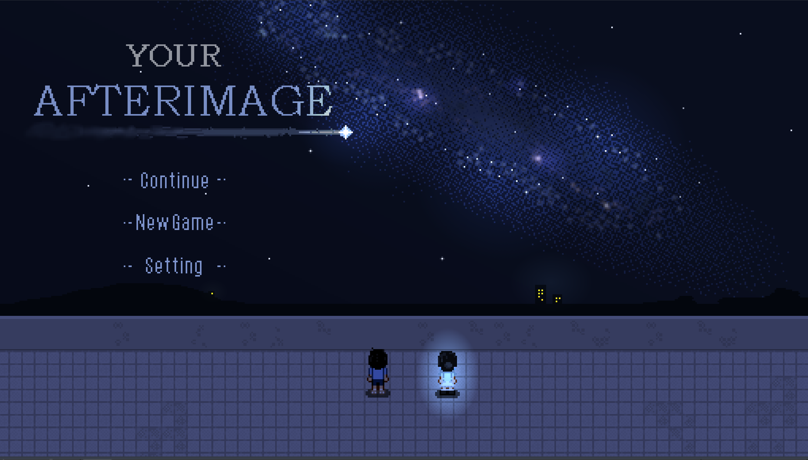
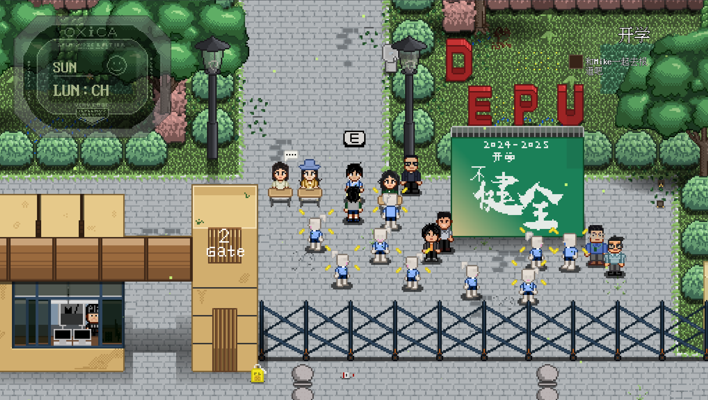
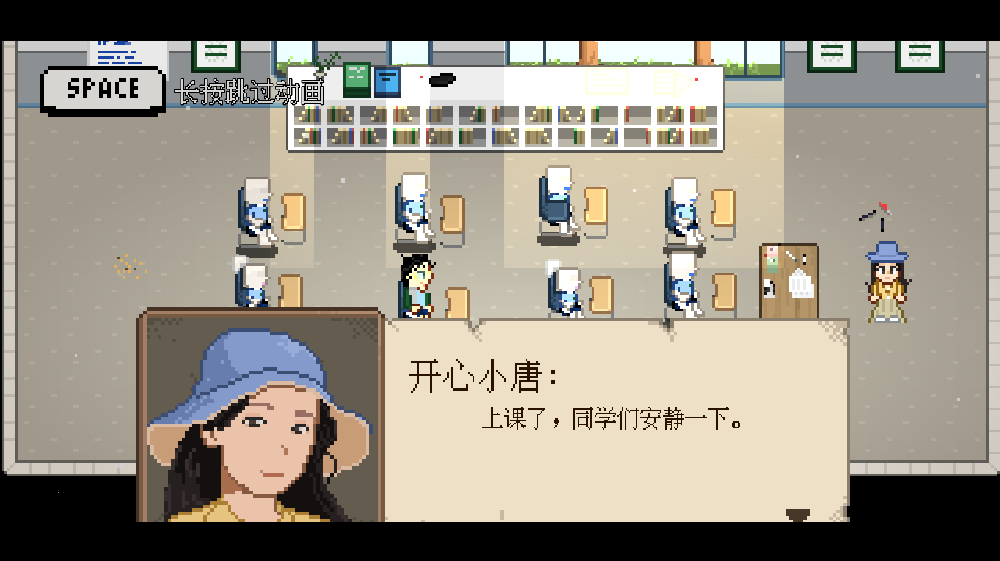
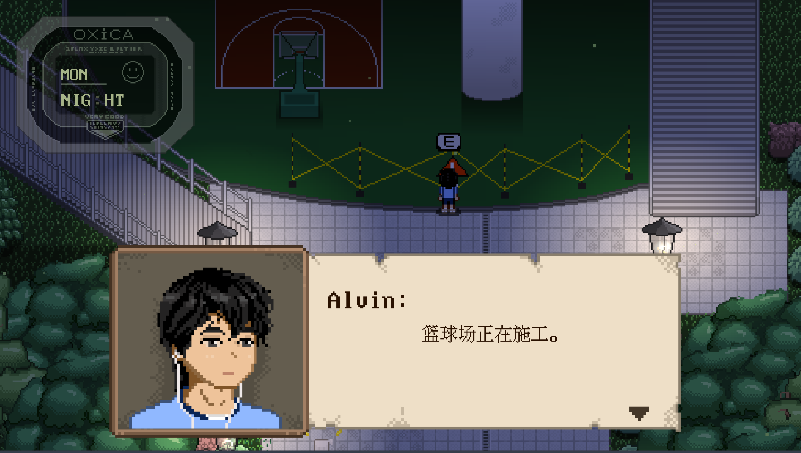
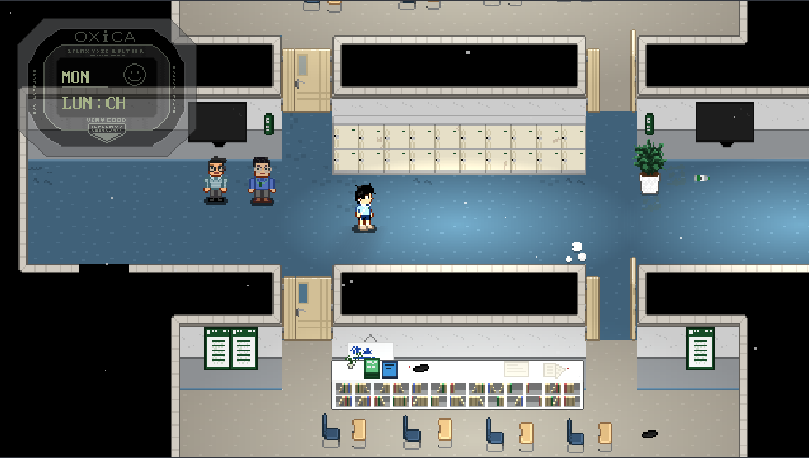

# Your Afterimage

A story-driven 2D pixel RPG set in a Chinese international high school, developed in Godot 4 using GDScript. 

The project is led by Litong Fang, with the inventory system developed by HaoYu Wang and integrated into the game by Litong Fang.

---

## Screenshots

### Main Menu




### Campus & Quest System



### Dialogue System



### Time & World State



### Teaching Building




---

## Core Systems

### Quest System

- Main and side quests with multiple progression states
- Multi-stage objectives and event-based progression
- Quest tracking UI and NPC quest markers
- Time-dependent quest conditions
- Quest progression can trigger dialogue, events and changes to the game world

Quest states are stored separately from gameplay logic and progress through states such as locked, unlocked, active and finished.

### Dialogue System

- Branching dialogue with player choices
- Multi-character conversations
- Player naming and character-name discovery
- Character portraits and emotion states
- Dialogue selected dynamically according to quest state and in-game time

NPC dialogue is loaded from external data and resolved against the current quest state rather than being hard-coded directly into individual NPC scripts.

### NPC System

- Reusable NPC base classes
- NPC schedules based on in-game day and time
- Quest-dependent NPC behaviour
- NPC following and classroom behaviour
- Reusable finite state machine for NPC behaviour

The NPC state machine currently supports behaviours including idle, following, background idle and in-class states, with shared `enter`, `update` and `exit` logic.

### Time & Daily Routine System

- Weekday and weekend progression
- Morning, lunch, dinner and night periods
- Different daily routines for school days and weekends
- Time-dependent quests, dialogue and NPC schedules
- Environment lighting changes according to the current time period

### World State System

- Quest progression can modify NPCs, objects and scene behaviour
- Persistent scene changes are recorded and reapplied
- NPC visibility, position and behaviour can change dynamically
- Default object schedules are applied according to day and time

The world-state controller listens for quest, time and scene events and refreshes the current scene accordingly.

### Inventory System

- Developed by HaoYu Wang, with project integration by Litong Fang.
- Pocket and backpack containers with stackable items
- Item pickup, including partial pickup when capacity is limited
- Drag-and-drop movement and swapping between slots and containers
- Item icons, stack counts and descriptions
- Dropping items into the world or discarding them

Item definitions use Godot resources, with signals keeping the inventory UI in sync with its contents.

### Save System

Saves and restores game progress using a JSON file. Supports a single save slot.

Saved data includes:
- Current scene and player position
- Inventory data
- Player name and known people
- Quest progress
- World state changes
- Current time and routine step

---

## Technical Design

The project is built around several independent managers and reusable gameplay systems rather than placing all gameplay logic inside individual scenes.

Key technical ideas include:

- **Data-driven design** — quest, dialogue, world-state and schedule data are stored externally
- **Event-driven communication** — Godot signals are used to communicate between quests, UI, time, scenes and world-state systems
- **Finite state machines** — NPC behaviour is separated into reusable states
- **Reusable NPC architecture** — NPC data, dialogue and behaviour are separated from individual scene instances
- **Quest-driven world state** — story progression can modify dialogue, NPC behaviour, objects and accessible areas
- **Data validation** — quest JSON is checked for required fields, valid quest types, state structure and time-condition values before use

---

## System Overview

```text
                    Time Manager
                         |
                         v
                   NPC Schedules
                         |
                         v
Quest Data ---> Quest Manager ---> Event Bus
                    |                |
                    |                +------> UI
                    |                |
                    v                +------> NPC Behaviour
              World State
                    |
          +---------+---------+
          |                   |
          v                   v
      Scene State          Events
          |
          v
   NPCs / Objects / Areas
```

```text
Quest Progress
      |
      v
NPC Dialog Resolver <---- Time Conditions
      |
      v
Dialogue Data (JSON)
      |
      v
Dialogue UI
```

---

## Tech Stack

- **Engine:** Godot 4
- **Language:** GDScript
- **Data:** JSON
- **Version Control:** Git / GitHub
- **Art:** Original and custom pixel-art assets

---

## Project Structure

### Core Managers

- QuestManager
- TimeManager
- DailyRoutineManager
- WorldStateController
- SceneManager
- EventBus
- SaveManager

### Quest & Dialogue

- QuestProgressStore
- QuestConditionChecker
- NPCDialogResolver
- Dialogue System

### NPC Behaviour

- NPCStateMachine
- Reusable NPC base classes

### Other Systems

- Inventory System

---

## Current Development

- Expanding story and quest content
- Extending the save system to support multiple save slots
- Improving UI feedback and handling edge cases
- Refining reusable systems and code structure
- Adding an interactive settings menu

---

## Credits

Litong Fang — Project lead; core gameplay systems, save-system development, inventory integration and all original pixel art.

HaoYu Wang — Inventory-system development.

## About the Project

This is an independent long-term project developed alongside my Aerospace Engineering studies at the University of Manchester.

The project began as an experiment in building a small narrative RPG and has gradually developed into a larger exercise in game-system architecture, data-driven design and state management.
